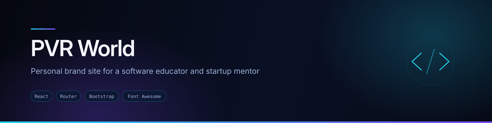
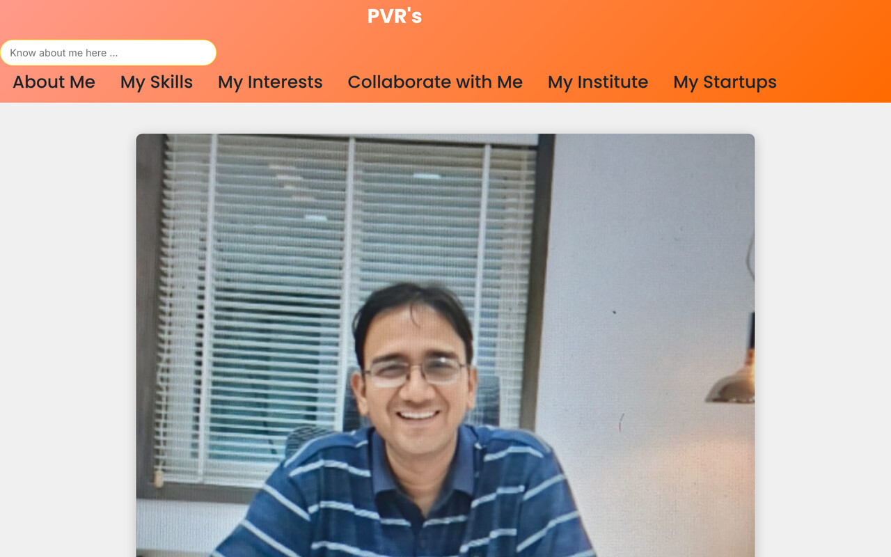

<div align="center">
  
</div>

<div align="center">


</div>

## Overview

Personal-brand website built for a **software educator, full-stack trainer and startup mentor** — "PVR World", tagline *Empowering the Next Generation of Coders*.

The brief was a site that works as a credibility page for several audiences at once: students deciding whether to enrol, companies considering a collaboration, and founders looking for a mentor. So rather than one long scroll, each audience gets a page.

## Preview



<sub>Screenshot captured from a local production build of this repository.</sub>

## Features

- **Nine routes**, each aimed at a different visitor:

  | Route | For |
  |---|---|
  | `/` | Landing page composing every section |
  | `/aboutme` | Background and credentials |
  | `/myskills` | Java, Python and full-stack teaching areas |
  | `/myinstitute` | The training institute |
  | `/mystartups` | Ventures and startup involvement |
  | `/myinterests` | Personal interests |
  | `/collabratewithme` | Collaboration enquiries |
  | `/blog` | Writing |
  | `/contact` | Contact |

- **Landing page** composing hero, about, skills, journey, projects, interviews, testimonials, FAQ, blog and newsletter in one scroll
- **Carousel** section for featured content
- **Testimonials and user stories** from students
- **Newsletter sign-up** form
- **Responsive layout** throughout

## Tech stack

| Layer | Technology |
|---|---|
| Framework | React (Create React App) |
| Routing | React Router DOM — 9 routes |
| Styling | Bootstrap CSS plus hand-written component CSS |
| Icons | Font Awesome, React Icons |

## Project structure

```
src/
├── Components/
│   ├── Project/        LandingPage composition
│   ├── Hero/, About/, Skills/, MyJourney/, Projects/
│   ├── InterViews/, Testimonals/, UserStories/
│   ├── Carousal/, CTA/, FAQ/, Blog/, NewsLetter/
│   ├── Navbar/, Footer/, Contact/
│   └── Assets/
├── Pages/              AboutMe, MySkills, MyInstitue, MyStartups,
│                       MyIntrests, Collabrate
└── App.js              9 route definitions
```

## Running locally

```bash
git clone https://github.com/AJAY2043/pvr_sir_website.git
cd pvr_sir_website
npm install
npm start
```

```bash
npm run build     # production build into ./build
```

## Future improvements

- **Wire the newsletter form to a real service.** `NewsLetter.jsx` has the submit handler stubbed with a commented-out `axios.post('/api/subscribe')` — it currently does nothing. EmailJS or a form endpoint would make it work without a backend.
- **Fix the spelling of the route and folder names** — `collabratewithme`, `MyIntrests`, `Testimonals`, `Carousal`. Worth doing in one pass, with redirects if the old URLs are live.
- Add meta tags and an Open Graph image so shared links preview properly
- Add a 404 route
- Remove unused dependencies — `axios` and `react-bootstrap` are declared but effectively unused

## Author

**Ajay Krishna Reddy Bhavanam** — Melbourne, Australia
[LinkedIn](https://linkedin.com/in/ajay-krishna-reddy) · [GitHub](https://github.com/AJAY2043)
